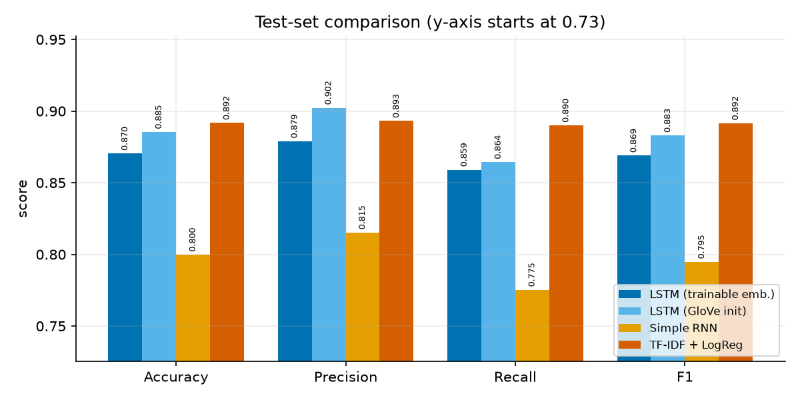
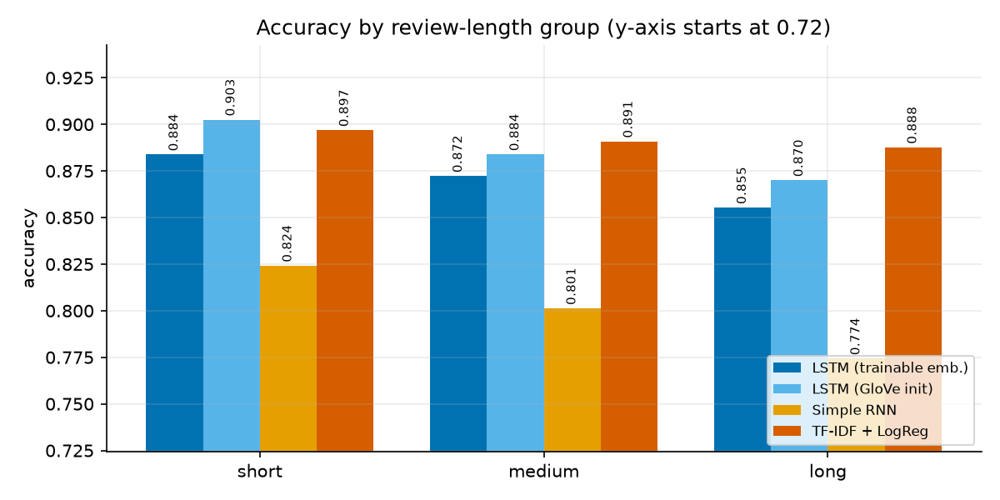
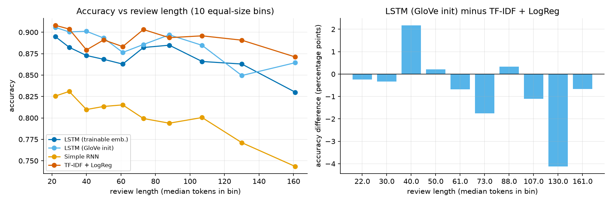

# Review Sentiment Classification with an LSTM — and the Effect of Review Length

An NLP project that classifies Amazon product reviews as **positive or negative** with an LSTM, compares it with a simple RNN and a TF-IDF + logistic-regression baseline, and studies **how review length affects accuracy**. Everything runs on a CPU, is seeded (42) and is reproducible with a single command. The full write-up is in [`REPORT.md`](REPORT.md) and viva preparation in [`VIVA_NOTES.md`](VIVA_NOTES.md).

## Problem statement

Develop an NLP model that classifies product reviews as positive or negative and examine how sentence length affects classification accuracy.

## Pipeline (7 steps, in `main.py`)

1. **Load** a labelled review dataset (balanced, stratified 70/15/15 split).
2. **Clean and tokenize**: lower-casing, HTML/URL removal, contractions expanded, negations kept, vocabulary of 20,000 words, padding/truncation to 170 tokens.
3. **Embeddings**: trainable 100-d embeddings, and GloVe-initialised embeddings.
4. **Train an LSTM** (packed sequences, early stopping, best checkpoint).
5. **Evaluate**: accuracy, precision, recall, F1, classification report, confusion matrix.
6. **Compare** with TF-IDF + logistic regression and a simple RNN.
7. **Sentence-length analysis**: short / medium / long groups, accuracy-vs-length bins, bootstrap confidence intervals, McNemar tests, error analysis.

## Dataset

[Amazon Polarity](https://huggingface.co/datasets/fancyzhx/amazon_polarity) (3.6 M training reviews; 1–2 stars = negative, 4–5 stars = positive, no neutral reviews). A **60,000-review balanced sample** (30,000 per class, review body only) is split into 42,000 train / 9,000 validation / 9,000 test.

## Models compared

| Model | Description |
|---|---|
| LSTM (trainable emb.) | Embedding → LSTM(128) → Dropout(0.4) → Linear → sigmoid |
| LSTM (GloVe init) | Same, embeddings initialised from GloVe 6B-100d and fine-tuned |
| Simple RNN | Same architecture with a tanh RNN instead of the LSTM |
| TF-IDF + LogReg | 1–2-gram TF-IDF, logistic regression (C chosen on validation data) |

## Results (test set, 9,000 reviews)

| Model | Accuracy | Precision | Recall | F1 | Train time (s) | Parameters |
|---|---|---|---|---|---|---|
| LSTM (trainable emb.) | 0.8704 | 0.8790 | 0.8591 | 0.8690 | 963 | 2,117,889 |
| LSTM (GloVe init) | 0.8854 | 0.9023 | 0.8644 | 0.8830 | 749 | 2,117,889 |
| Simple RNN | 0.7999 | 0.8154 | 0.7753 | 0.7949 | 169 | 2,029,569 |
| TF-IDF + LogReg | **0.8918** | 0.8932 | 0.8900 | 0.8916 | 13.5 | 200,001 |

Accuracy by review length (short ≤ 48 tokens, medium 49–92, long ≥ 93; tertiles of the training lengths):

| Model | Short | Medium | Long |
|---|---|---|---|
| LSTM (trainable emb.) | 0.8838 | 0.8723 | 0.8553 |
| LSTM (GloVe init) | 0.9025 | 0.8839 | 0.8700 |
| Simple RNN | 0.8242 | 0.8013 | 0.7743 |
| TF-IDF + LogReg | 0.8969 | 0.8908 | 0.8877 |



## Key finding: sentence length

* All neural models **lose about 3–5 points** of accuracy from short to long reviews (LSTM 2.8–3.3 points, RNN 5.0 points); the drops are statistically significant (p ≤ 0.001).
* The **TF-IDF baseline barely changes** (−0.9 points from short to long, p = 0.27, not significant).
* On short reviews the GloVe LSTM is +0.6 points ahead of TF-IDF (not significant); on long reviews it is **1.8 points behind** (95 % CI −3.0 to −0.5, McNemar p = 0.005). The LSTM's advantage therefore shrinks with length, so the expectation that LSTMs beat bag-of-words models on long text is **not supported** here.
* Long-review errors are mostly mixed opinions spread over many sentences; truncation is not the main cause.




## Project structure

```
main.py                 # runs steps 1-7 end to end
src/
  config.py             # hyper-parameters, paths, seeds
  data.py               # step 1: load, balance, split
  preprocess.py         # step 2: clean, tokenize, vocabulary, padding
  models.py             # steps 3-4: embeddings (+GloVe), LSTM / RNN
  train.py              # step 4: training loop, early stopping
  evaluate.py           # step 5: metrics, reports
  baseline.py           # step 6: TF-IDF + logistic regression
  length_analysis.py    # step 7: groups, bins, statistics, error analysis
  plots.py              # all figures
scripts/build_notebook.py
notebooks/              # executed notebook with outputs
results/                # CSV tables, classification reports, run log, error examples
figures/                # PNG plots
REPORT.md  VIVA_NOTES.md
```

## Setup and run

```bash
python -m venv .venv
.venv\Scripts\activate            # Linux/macOS: source .venv/bin/activate
pip install torch --index-url https://download.pytorch.org/whl/cpu
pip install -r requirements.txt

python main.py                    # full run, about 30 min on a 4-thread CPU
python main.py --quick            # ~2-minute smoke test (writes to runs/quick/)
python scripts/build_notebook.py  # rebuild notebooks/NLP_Review_Sentiment.ipynb from results/
```

Downloads happen automatically on the first run: the Amazon Polarity dataset comes from Hugging Face (the 60k sample is cached in `data/`), and GloVe 6B (`glove.6B.zip`, about 860 MB) is fetched once into `data/glove_raw/`. If GloVe cannot be downloaded the GloVe LSTM is skipped. If you are offline, place your own `data/custom.csv` with columns `text,label` (1 = positive, 0 = negative). `data/`, model checkpoints and GloVe files are not stored in the repository.

## Limitations

* **Single seed (42)**: one training run per model, so seed-to-seed variation is not measured.
* **60k subsample** of the 3.6 M available reviews, one dataset only.
* **6-epoch cap** (with early stopping; the LSTMs stopped after 4–5 epochs, the RNN used all 6).
* **170-token truncation** (95th percentile of training lengths; 2.8 % of test reviews are cut, the TF-IDF baseline reads the full text).
* Length is confounded with content (long reviews contain more mixed opinions); the LSTM is small and unidirectional.

## License

Released under the MIT License (see [`LICENSE`](LICENSE)). The Amazon Polarity dataset and GloVe vectors keep their own licences and terms.
