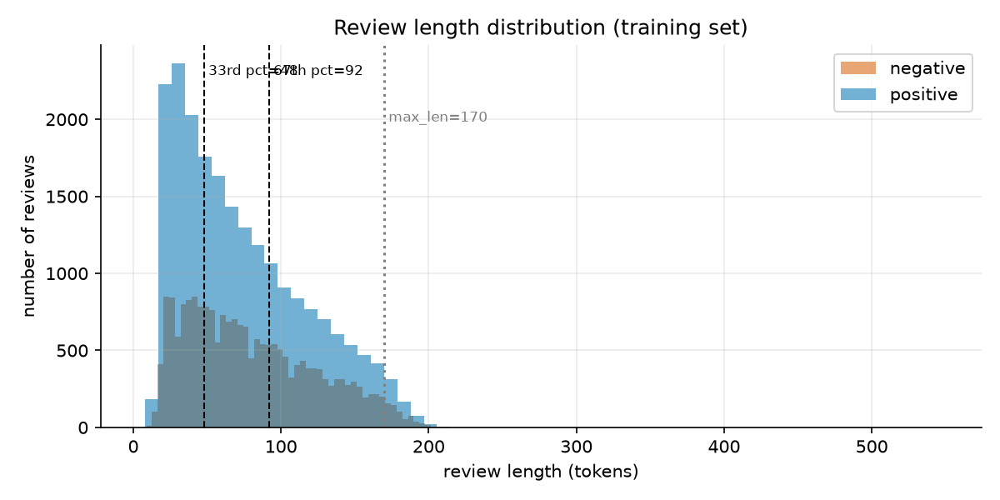
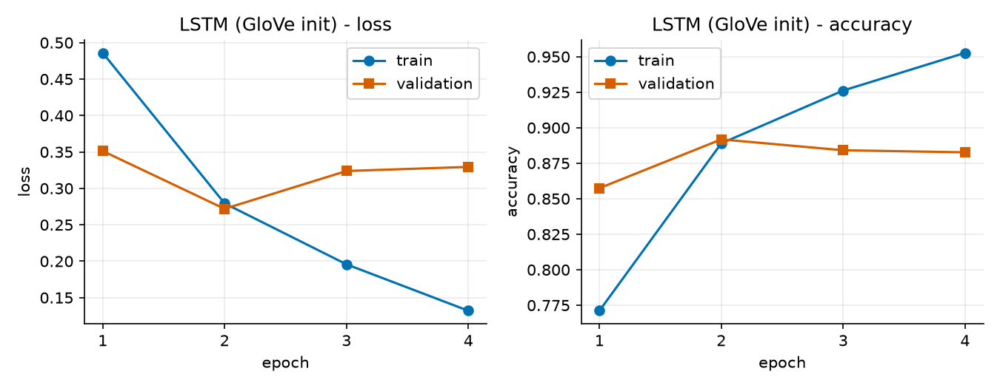
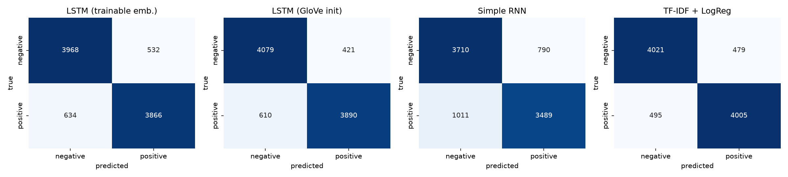
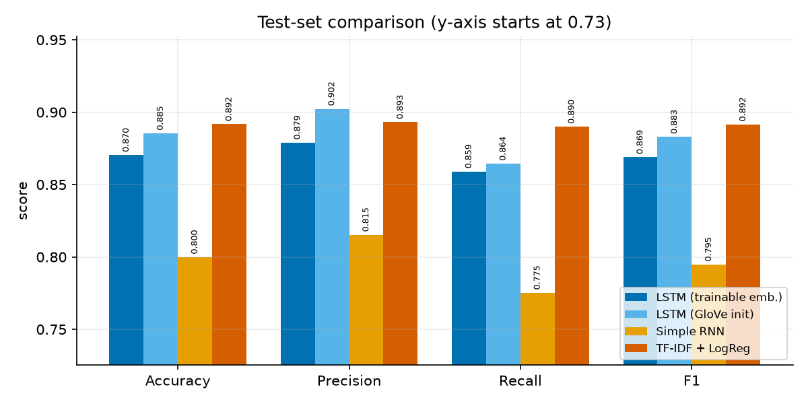
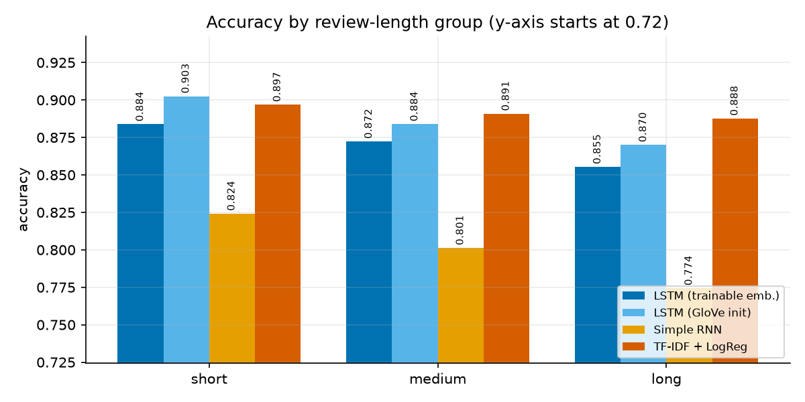
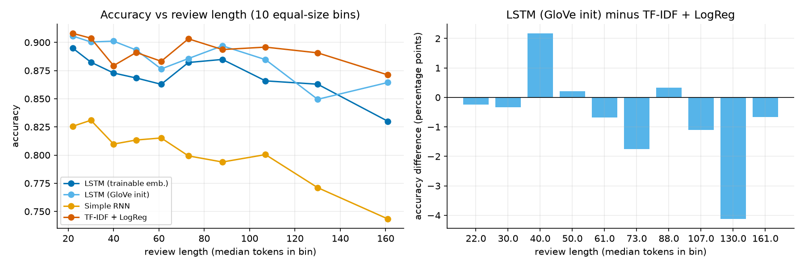

# Sentiment Classification of Product Reviews with an LSTM, and the Effect of Review Length

*All numbers below come from the run stored in `results/` (seed 42, CPU only). Training times depend on the machine; every other number is reproducible with `python main.py`.*

## 1. Introduction

The task is to classify Amazon product reviews as **positive** or **negative** and to study **how review length affects classification accuracy**. An LSTM (a recurrent network that reads a review word by word) is compared with a simple RNN and a classical TF-IDF + logistic-regression baseline. The seven required steps map to the sections below:

| Step | Section |
|---|---|
| 1 Load dataset | 2 |
| 2 Clean + tokenize | 3 |
| 3 Embeddings, 4 LSTM | 4, 5 |
| 5 Evaluation, 6 Comparison | 6.1, 6.2 |
| 7 Short vs long reviews | 6.3 |

## 2. Dataset (Step 1)

* **Source:** *Amazon Polarity* (Hugging Face `fancyzhx/amazon_polarity`, 3.6 M training reviews). 1–2 star reviews are negative, 4–5 star are positive; 3-star reviews are already excluded.
* **Sample used:** 60,000 reviews, drawn at random with exactly 30,000 per class (**perfectly balanced**), review body only (the title is not used, because it often states the sentiment in 2–3 words and would hide the length effect).
* **Split:** stratified 70/15/15: **42,000 train / 9,000 validation / 9,000 test** (each exactly 50% positive).
* Sample rows are in `results/dataset_samples.csv`. Example negative: *"Fog Hat made only one good song they ever did, Slow Ride, therest of the CD is crap!!!!!!"*

## 3. Preprocessing (Step 2)

1. Lower-case; remove HTML tags and URLs.
2. Expand contractions so negation survives as a separate token (`didn't` → `did not`, `can't` → `can not`); numbers → `num`.
3. Keep only letters, digits, `!` and `?` (the last two are strong sentiment cues). **Stop-words are not removed**: *not, no, never* flip the meaning.
4. Tokenize (NLTK `RegexpTokenizer`).
5. Vocabulary = 20,000 most frequent training tokens (`<PAD>`=0, `<UNK>`=1; words seen < 2 times map to `<UNK>`). Built on the training set only, to avoid leakage.
6. Sequences are padded/truncated to **max_len = 170 tokens** = 95th percentile of training lengths rounded up to a multiple of 10. Only **2.8 %** of test reviews are truncated (the first 170 tokens are kept).

Review length in the training set: mean 76.8, median 68, std 43.9, min 5, max 547 tokens.

## 4. Embeddings (Step 3)

An `nn.Embedding` layer maps each token id to a 100-dimensional vector that is learned with the classifier. Two variants were trained:

* **Trainable embeddings** – random initialisation, learned from 42k reviews.
* **GloVe-initialised** – the vectors start from pretrained GloVe 6B-100d (covers 98.4 % of our vocabulary) and are then fine-tuned. Pretrained vectors already encode that *great* ≈ *excellent*, which helps with a small training set.

## 5. Model architecture and experimental setup (Step 4)

**LSTM:** Embedding(20000×100) → LSTM(128 hidden, 1 layer) → Dropout(0.4) → Linear(128→1) → sigmoid (inside `BCEWithLogitsLoss`). Reviews are fed as **packed sequences**, so padding is ignored and the last hidden state is the state after the last *real* word. 2,117,889 trainable parameters (most are embeddings).

**Simple RNN:** identical, but `nn.RNN` (tanh) instead of LSTM: 2,029,569 parameters.

**Baseline:** TF-IDF on 1–2-grams (max 200k features, sublinear tf) + logistic regression; the regularisation strength C ∈ {0.5, 2, 8} was chosen on validation data (C = 8). 200,001 parameters. It reads the full, untruncated text.

**Training:** Adam (lr 0.002), batch 128, gradient clipping 1.0, at most 6 epochs, **early stopping** on validation loss (patience 2), best checkpoint restored (`models/`). Seed 42 everywhere. The "main LSTM" is the LSTM variant with the higher *validation* accuracy (GloVe); the test set was never used for any choice.

The LSTM starts to overfit quickly: GloVe-LSTM validation loss is lowest after epoch 2 (val acc 0.892) while training accuracy keeps rising (0.953 by epoch 4); the trainable-embedding LSTM peaks at epoch 3. Curves for the other models are in `figures/training_curves_*.png`.

## 6. Results

### 6.1 Evaluation on the held-out test set (Step 5; n = 9,000)

Metrics are for the positive class (precision = of predicted positives, how many are right; recall = of real positives, how many are found).

Classification report of the main LSTM (GloVe):

| class | precision | recall | F1 |
|---|---|---|---|
| negative | 0.8699 | 0.9064 | 0.8878 |
| positive | 0.9023 | 0.8644 | 0.8830 |
| accuracy | | | 0.8854 |

Confusion matrix (rows = true, columns = predicted): negative → 4079 correct / 421 wrong; positive → 610 wrong / 3890 correct.

### 6.2 Model comparison (Step 6)

| Model | Accuracy | Precision | Recall | F1 | Train time (s) | Parameters |
|---|---|---|---|---|---|---|
| LSTM, trainable emb. | 0.8704 | 0.8790 | 0.8591 | 0.8690 | 963 | 2,117,889 |
| **LSTM, GloVe init** | 0.8854 | 0.9023 | 0.8644 | 0.8830 | 749 | 2,117,889 |
| Simple RNN | 0.7999 | 0.8154 | 0.7753 | 0.7949 | 169 | 2,029,569 |
| **TF-IDF + LogReg** | **0.8918** | 0.8932 | 0.8900 | 0.8916 | 13.5 | 200,001 |

**Discussion.** The simple TF-IDF + logistic-regression baseline is the most accurate model overall, and it trains about 55× faster than the best LSTM. The GloVe-LSTM is 0.63 points behind (95 % bootstrap CI of the difference: −1.28 to +0.04 points; McNemar p = 0.062, so not clearly different). GloVe initialisation gives +1.5 points over random embeddings and made the LSTM converge faster. The simple RNN is clearly worst (−9.2 points vs. the baseline), consistent with its difficulty learning from long sequences (vanishing gradients). That a linear model matches an LSTM is not surprising for *review polarity*: sentiment is carried largely by individual words and phrases ("waste", "love", "not worth"), which bigram TF-IDF captures directly, and with only 42k training reviews and a small model the LSTM cannot exploit word order much more.

### 6.3 Sentence-length analysis (Step 7)

**Definition.** Length = number of tokens after cleaning. Groups are **tertiles of the training length distribution**, so the thresholds do not use test data: **short ≤ 48 tokens, medium 49–92, long ≥ 93** (test sizes 2,986 / 3,014 / 3,000; mean length 32 / 69 / 130 tokens).

**Accuracy per length group** (95 % bootstrap CI, 2,000 resamples, in brackets):

| Model | Short | Medium | Long | Short − Long |
|---|---|---|---|---|
| LSTM trainable | 0.8838 [.872, .896] | 0.8723 | 0.8553 [.843, .868] | +2.85 pts (p = 0.001) |
| **LSTM GloVe** | 0.9025 [.892, .913] | 0.8839 | 0.8700 [.857, .882] | +3.25 pts (p < 0.001) |
| Simple RNN | 0.8242 [.810, .838] | 0.8013 | 0.7743 [.759, .789] | +4.98 pts (p < 0.001) |
| TF-IDF + LogReg | 0.8969 [.886, .909] | 0.8908 | 0.8877 [.876, .899] | +0.92 pts (p = 0.27, n.s.) |

Full precision/recall/F1 per group and model: `results/metrics_by_length_group.csv`.

**Accuracy by length bin** (10 equal-size bins of ≈ 900 reviews; the right panel shows LSTM − baseline):

**Statistical check.** Differences between short and long are *significant for all three neural models* (chi-square p ≤ 0.001; bootstrap CIs of the gap exclude 0) but *not for the TF-IDF baseline* (CI −0.6 to +2.5 points). LSTM-vs-baseline (paired bootstrap + McNemar test):

| Group | LSTM (GloVe) | TF-IDF+LR | Difference | 95 % CI | McNemar p |
|---|---|---|---|---|---|
| Short | 0.9025 | 0.8969 | +0.57 pts | [−0.44, +1.57] | 0.31 |
| Medium | 0.8839 | 0.8908 | −0.70 pts | [−1.79, +0.36] | 0.24 |
| Long | 0.8700 | 0.8877 | **−1.77 pts** | [−2.97, −0.53] | 0.005 |

The *change* in the LSTM's advantage from short to long reviews is −2.34 points (95 % CI −3.98 to −0.73), i.e. the LSTM's relative position gets significantly worse as reviews get longer.

**Error analysis** (main LSTM; samples in `results/error_examples.md`, 8 short + 8 long random errors):

*Short errors (≤ 48 tokens; 291 errors, 9.7 %).*
* *Mixed sentiment inside a short text:* "I have bought the best facial cleanser… Amazing Grace is lovely… **Don't buy Falling in Love. It's yucky.**" (true neg, P(pos) = 0.97) – praise for other products dominates one negative verdict.
* *Negative-sounding content, positive verdict:* "stopped my dizzy spells and decreased the ringing in my ears" (true pos, P(pos) = 0.11): words like *dizzy, ringing* look negative.
* *Sentiment without sentiment words / irony:* "REally thought this was a collection of comic books. It ended up being a cartoon DVD" (neg, predicted 0.90); "In this **"improved"** set up…" (quote marks signal sarcasm).
* *Contrast and probable label noise:* "it is well built… however… amazon does not allow me [to return it]" labelled positive.
* Of these 8 short errors the TF-IDF baseline got 2 right and 6 wrong, so many short errors are shared by both models (inherently ambiguous or noisy texts).

*Long errors (≥ 93 tokens; 390 errors, 13.0 %).*
* Typically **mixed sentiment spread over many sentences** – praise of the author's other work followed by "Unfortunately… save your time and skip this one" (neg, P = 0.57); an ice-crusher that is great at one thing and unusable at another; a camera review with "pros and cons for every single one".
* Most long errors are *low-confidence* (P(pos) between 0.25 and 0.57 for 7 of 8 samples): the LSTM sees both polarities and its single final hidden state cannot weigh them well.
* Casual, unpunctuated text (the Ryan Adams review, "i don't know why, but it put its hooks in me").
* **In all 8 sampled long errors the TF-IDF baseline was correct** – it sums evidence over *all* words, whereas the LSTM must squeeze everything into one vector.
* *Truncation is not the main cause:* only 2.8 % of test reviews are truncated, and the share of truncated reviews among long errors (9.2 %) is close to that among long correct predictions (8.2 %). None of the 8 sampled errors is truncated.
* Cue rates (`results/error_cue_rates.csv`): contrast words (*but, however, although…*) appear in 74.6 % of long errors vs. 70.5 % of long correct predictions and in 34.4 % of short errors vs. 26.9 % of short correct ones; negation words appear in 88 % of long reviews regardless of correctness (they are simply common in long text), so negation alone does not separate errors here. These are descriptive; no significance test was run on them.

**Conclusion on length.** Longer reviews are harder for every neural model: accuracy falls from 90.3 % (short) to 87.0 % (long) for the GloVe-LSTM, and from 82.4 % to 77.4 % for the RNN. The TF-IDF baseline is almost length-independent (89.7 % → 88.8 %, not significant). Consequently the LSTM's advantage over the baseline *shrinks with length*: it is +0.6 points (not significant) on short reviews and becomes −1.8 points (significant) on long ones. **In this experiment the LSTM does not beat the baseline on long text; the expectation "LSTMs are better on long text" is not supported.**

## 7. Limitations

* **Single seed:** every result comes from seed 42 (one training run per model).
* **Truncation:** reviews are cut to the first 170 tokens (2.8 % of test reviews are affected); the TF-IDF baseline reads the full text.
* **Subsampling:** only 60,000 of the 3.6 M available reviews were used, with training capped at 6 epochs, to keep CPU training feasible.
* One dataset (Amazon Polarity), one 60k sample, one random seed; no repeated runs, so seed-to-seed variation of the LSTM (probably a few tenths of a point) is not measured. The overall LSTM-vs-baseline difference (−0.63 pts) is not significant, and the length analysis is on one trained model per type.
* Length is confounded with content: long reviews tend to contain more mixed opinions, so "length" and "mixed sentiment" cannot be separated here.
* Review lengths in this dataset are capped (test max 200 tokens, 97 % under 170); results for very long documents (500+ tokens) are not covered, and the LSTM only reads the first 170 tokens.
* Small, unidirectional LSTM, no hyper-parameter search beyond the baseline's C; a bidirectional LSTM, attention or a pretrained transformer would likely do better.
* Labels are star-derived and noisy (some "positive" reviews contain complaints).
* Training time depends on hardware (4 CPU threads here).

## 8. Conclusion

A GloVe-initialised LSTM reaches 88.5 % test accuracy (F1 0.883) on balanced Amazon reviews, clearly beating a simple RNN (80.0 %) but not the TF-IDF + logistic-regression baseline (89.2 %), which is also ~55× faster to train. Review length matters: all neural models lose accuracy on long reviews (−3 to −5 points between the shortest and longest thirds), the baseline does not, and the LSTM's small advantage on short reviews turns into a significant disadvantage on long ones. Errors on long reviews are dominated by mixed opinions; errors on short reviews by sarcasm, implicit sentiment and label noise.
